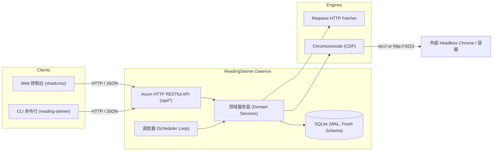

# ReadingSteiner 架构与 UI/UX 现代重构方案

> **状态**：方案已对齐，待进入实现阶段  
> **核心目标**：彻底清理含糊不清的设计、移除 camofox 改用 chromiumoxide 远程 CDP、CLI 统一为 HTTP 客户端、全面升级为基于 shadcn/ui 的暗黑极简高效控制台。

---

## 1. 架构精简与重塑

### 1.1 通信与传输层（单通道 RESTful API）
* **废弃独立 Socket 协议**：移除 `src/control.rs` 及 Unix/TCP socket 行协议守护监听。
* **统一 HTTP RESTful API**：所有前端页面与 CLI 均作为轻量 HTTP 客户端访问 Axum 驱动的 HTTP API（默认 `127.0.0.1:8901`，支持可选 Bearer Auth）。
* **CLI 工具角色转变**：`reading-steiner serve` 负责启动后台服务与 Web 服务；其余子命令（`status`、`check <id>`、`sources add/list`、`diff <id>` 等）通过轻量 `reqwest` 调用 daemon 的 REST API。



---

## 2. 领域模型与规则清理（告别含糊设计）

### 2.1 彻底抛弃 Tag 隐式继承，引入明确的 Group（站点预设/模板）
* **旧设计痛点**：多 Tag 随意组合，多标签冲突时按字母排序选第一个，源级配置被隐式覆盖且前端表单直接强行置灰，令人困惑。
* **新设计**：
  * 废除 `tags` 表与 `follow_group` 开关。
  * 引入 `groups`（站点分组/预设）表：
    * `id`, `name`, `default_cron`, `default_headers`, `default_browser_config`, `default_extract`, `default_notify_url`。
  * 监控源拥有唯一的 `group_id: Option<String>`。
  * **同站点多页面秒建**：选择 Group 后，自动预填或继承该 Group 的提取规则与通知配置，用户仅需填入 URL 与名称即可一键添加。

### 2.2 规范清晰的内容提取模型（ExtractConfig）
放弃原先整页 Text 与复杂多字段 Items 的割裂，规范为 3 种直观模式：

1. **`Text` 模式（文本提取）**：
   * 支持指定可选 `selector: Option<String>`（CSS 选择器），如 `#article-body` 或 `.price-tag`。
   * 未指定选择器时监控整页纯文本。
2. **`Json` 模式（JSON 接口提取）**：
   * 支持指定可选 `json_path: Option<String>`，如 `$.data.version` 或 `$.status`。
   * 未指定时监控整个 JSON 格式化文本。
3. **`Items` 模式（结构化条目列表）**：
   * 针对多条目（如 Releases 列表、博文列表、商品列表）。
   * 配置根选择器（`selector`，支持 CSS 或 JSONPath）及子字段提取列表（`title`、`url` 等）。
   * 自动对比新增、更新与删除条目。

### 2.3 规范图片与快照机制
* 移除脆弱的 DOM 变更级图片反查（`Changed`）。
* 明确图片来源：
  * `none`：不发图片。
  * `first_item`：附带条目列表提取到的首张图片。
  * `css`：指定 CSS 选择器抓取特定 ``。
  * `screenshot`：浏览器引擎检测到变更时全屏/指定元素截图并推送。

---

## 3. 浏览器引擎重构：Chromiumoxide 替代 Camofox

* **彻底删除 Camofox**：
  * 删除 `src/fetcher/camofox.rs`、`camofox-openapi.json`、`docs/camofox.md`。
  * 清理 `config.yaml` 与 `nixos/module.nix` 中的 camofox 冗长字段（session key, access key, token files）。
* **引入 `chromiumoxide`**：
  * **纯外部 CDP 连接**：daemon 保持纯轻量化，不负责拉起本地 Chrome 进程，通过配置中的 `cdp_url`（如 `http://127.0.0.1:9222`）连接外部运行的无头 Chrome/Chromium 容器。
  * **配置精简（config.yaml）**：
    ```yaml
    browser:
      enabled: false
      cdp_url: "http://127.0.0.1:9222"
      timeout_secs: 30
    ```
  * **抓取执行流**：
    * 借出/复用 CDP 连接打开临时 Context/Page。
    * 自定义请求头注入、User-Agent 模拟。
    * 页面跳转 `page.goto(url)` 并等待 DOM 渲染或特定选择器。
    * 可选执行预注入 JS（`evaluate`）。
    * 提取完整 HTML 或目标元素内容。
    * 如需截图则直接调用 `page.screenshot(...)` 输出图片至 `media_dir`。
    * 任务完成后可靠关闭 Page，杜绝句柄与内存泄露。

---

## 4. 前端重塑：现代化 shadcn/ui 控制台

### 4.1 视觉风格与框架选型
* **视觉基调**：暗黑优先（Dark-mode First）+ 浅色切换，基于 Vercel / Linear 的极简无衬线高质感设计（Zinc / Slate 纯色系、精致 1px 细边框、微交互动画）。
* **组件库**：全套采用 **shadcn/ui** 原生规范与 Radix UI primitives。
* **通知与交互**：引入 `Sonner` 吐司通知、`Lucide React` 图标集。

### 4.2 布局架构（Sidebar + Topbar + Sheet）
```text
┌───────────────┬────────────────────────────────────────────────────────┐
│  Reading      │ 顶栏：面包屑 · 快速状态指标 · 搜索 · 亮暗色切换 · 帮助      │
│  Steiner      ├────────────────────────────────────────────────────────┤
├───────────────┤ 主操作区：                                             │
│ 📌 监控源     │  [+ 新建监控源]  [分组筛选 ▾]  [状态筛选 ▾]  [批量操作 ▾]    │
│ 📁 站点分组   │ ┌────────────────────────────────────────────────────┐ │
│ 🕒 变更历史   │ │ 高信息密度数据表格（名称、URL、分组、频率、状态、操作）│ │
│ ⚙️ 系统设置   │ └────────────────────────────────────────────────────┘ │
│               ├────────────────────────────────────────────────────────┤
│               │ 侧边抽屉 (Sheet)：新建/编辑监控源 & 实时抓取测试抽屉    │
│               │  - Step 1: 基础属性与分组（自动继承预设）               │
│               │  - Step 2: 抓取引擎（HTTP / 浏览器）                   │
│               │  - Step 3: 提取规则（实时一键抓取预览提取结果与截图）    │
│               │  - Step 4: 调度与通知设置                              │
└───────────────┴────────────────────────────────────────────────────────┘
```

### 4.3 核心功能页面规划
1. **监控源（Sources）**：
   * 支持表格与卡片双视图切换。
   * 快捷行内操作：即刻检测（Check Now）、暂停/恢复、编辑、查看历史、删除。
   * 批量选中批量启停与删除。
2. **站点分组（Groups / Presets）**：
   * 列表展示各站点模板（如 GitHub Releases、V2EX 节点、官方博客）。
   * 一键从该 Group 创建新源。
3. **变更历史与 Diff 对比器（Events & Diffs）**：
   * 全局/单源变更事件时间线。
   * 嵌入式高亮 Diff 对比器（视觉对比变动前后的字段与文本）。
   * 附带图片/网页截图灯箱查看（Lightbox）。
4. **实时抓取测试器（Live Inspector Drawer）**：
   * 无论是新建还是编辑，无需保存即可一键模拟抓取，即时查看抓取耗时、状态码、提取到的结构化字段或文本预览、浏览器实时截图。

---

## 5. 实施里程碑

1. **里程碑 1：清理冗余与纯净 Schema**
   * 移除 `src/control.rs`，删除 `camofox` 模块与契约文件，重构 `src/cli.rs` 为纯 HTTP 客户端。
   * 清理 `Cargo.toml`，引入 `chromiumoxide`。
   * 重建 SQLite v1 纯净 Schema（`sources`, `groups`, `change_events`, `snapshots`, `settings`, `media_cache`）。
2. **里程碑 2：后端核心（Chromiumoxide + 领域服务 + Axum 路由）**
   * 实现基于外部 CDP 的 `BrowserFetcher`。
   * 重构 `ExtractConfig` 三大模式（Text, Json, Items）与 Differ。
   * 补全 Axum RESTful API（CRUD 源、分组、配置、测试提取接口 `/api/sources/test`、历史）。
3. **里程碑 3：shadcn/ui 前端重构**
   * 配置 Vite + Tailwind + shadcn/ui 组件库。
   * 搭建 Sidebar + Topbar 主壳，实现 Sources 表格与操作。
   * 实现 Groups 模板管理。
   * 实现侧滑抽屉与 Live Inspector 测试器。
   * 实现漂亮的高亮 Diff 历史查看器与设置中心。
4. **里程碑 4：测试套件、NixOS 配置与交付验证**
   * 编写单元测试与集成测试（Mock CDP 与 HTTP）。
   * 更新 `nixos/module.nix`、`flake.nix`、`config.yaml` 与相关文档。
   * 端到端验证打包运行。
